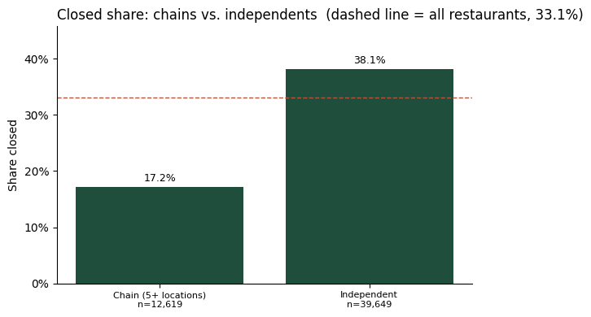
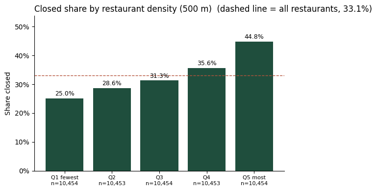
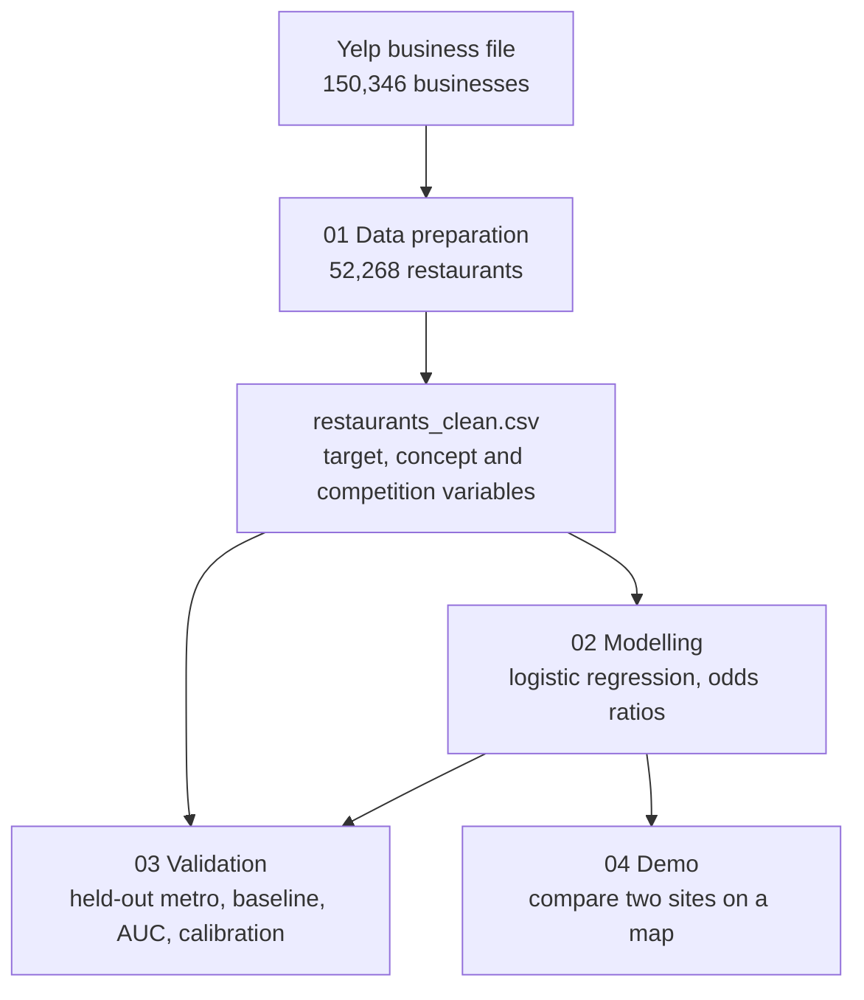

# SiteScore

**Can a restaurant founder see closure risk coming before signing a lease?**

SiteScore is a site-screening tool for restaurant founders, franchise teams, landlords and lenders. Drop a pin, choose a cuisine and price level, and get a closure-risk score with the factors behind it. It is built on an interpretable logistic regression trained on the [Yelp Open Dataset](https://business.yelp.com/data/resources/open-dataset/).

MGSC 661 Multivariate Statistics, McGill University (Fall 2026) · Hasan Malik, Pranjal Singh, Yangyang, Dario

---

## Key findings

**Data (notebook 01).** 52,268 restaurants across 11 metro areas; 33.1% closed at the Yelp snapshot. Unadjusted, chains close far less than independents (17.2% vs 38.1%), and the busiest locations close far more than the quietest (44.8% vs 25.0% for the top and bottom fifth by restaurants within 500 m). The density pattern holds when only open neighbours are counted (26.0% → 44.0%).

<p>
  
  
</p>

**Model (notebook 02).** Holding the other inputs fixed (odds ratios from the logistic regression):

| Factor | Effect on the odds of being closed |
|---|---|
| Chain (5+ locations) vs independent | about 64% lower |
| Doubling the restaurants within 500 m | about 12–16% higher |
| Any same-cuisine restaurant within 500 m | about 28% higher |
| Each price tier away from the neighbourhood average | about 19% higher |

The ranges cover the model with metro controls (Step 4) and the validated SiteScore model without them (Step 8); the exact SiteScore odds ratios are in Step 8 and `reports/figures/odds_ratios_sitescore.png`.

**Validation (notebook 03).** Trained without Indianapolis and tested on it, the model reaches **AUC 0.687**, versus 0.671 for concept alone and 0.618 for chain status alone. Across all 11 held-out metros AUC ranges from 0.614 to 0.710 (mean 0.672), and predicted risk matches observed closure closely (mean 30.3% predicted vs 31.7% observed). Ranking is weaker among independent restaurants (AUC 0.627). See the [validation summary](docs/validation_summary.md).

## Workflow



| Step | Notebook | Status | What it does |
|---|---|---|---|
| 01 | [`notebooks/01_data_prep.ipynb`](notebooks/01_data_prep.ipynb) | Done | Filters restaurants, builds the target, metro, price, cuisine, chain and competition variables, runs quality checks, saves charts |
| 02 | [`notebooks/02_modelling.ipynb`](notebooks/02_modelling.ipynb) | Done | Logistic regression built up in blocks; odds ratios, clustered significance, diagnostics; the final SiteScore model (Step 8) |
| 03 | [`notebooks/03_validation.ipynb`](notebooks/03_validation.ipynb) | Done | Training-only grouped CV and threshold selection; held-out metro and baselines; bootstrap AUC intervals; all-metro, radius and chain-cutoff checks |
| 04 | [`demo/`](demo/README.md) | Done | Interactive tool: place two sites on a map, pick a concept, compare their risk bands and what drives them |

## Data

The Yelp data is **not included** in this repository: Yelp licenses it for educational use and it should not be redistributed. See [`data/README.md`](data/README.md) for how to get it. Notebook 01 can download the one file it needs (the business file, about 120 MB) directly from Kaggle.

### Variables in the SiteScore model

| Variable | Meaning |
|---|---|
| `closed` | Target: 1 = permanently closed at the Yelp snapshot (1 − `is_open`) |
| `price_tier` | Yelp price range 1–4, or "Missing" |
| `cuisine_group` | One of 14 cuisine groups |
| `is_chain` | Name appears at 5+ restaurants in the data |
| `log_n_rest_500m` | log(1 + other restaurants within 500 m) |
| `has_same_cuisine_nbr` | At least one same-cuisine restaurant within 500 m |
| `abs_price_gap`, `price_gap_missing` | Distance from the local average price, in either direction |

The SiteScore model has no metro dummies, so it can score a city it was not trained on. Notebook 02 also fits a version with `metro` and the same-cuisine *share* (Step 4) as a robustness check.

The full data dictionary and every data decision are in [`reports/data_prep/`](reports/data_prep/README.md) (notebook 01 writes fresh copies to `notebooks/outputs/` each time it runs).

**Leakage rule:** no ratings, review counts, check-ins or neighbours' closure flags are used as inputs, because they are only known after opening or reflect the outcome itself.

## How to run

**Google Colab (easiest):** open a notebook from this repo in Colab (File → Open notebook → GitHub), then *Runtime → Run all*. Notebook 01 downloads the data from Kaggle; you need a free Kaggle account.

**Locally (VS Code or Jupyter):**

```bash
git clone <this repo's URL>
cd sitescore
pip install -r requirements.txt
```

Then open `notebooks/01_data_prep.ipynb`, set `DATA_SOURCE` in Step 0 (`"kaggle"`, `"drive"` or `"local"`), and run all cells. Outputs are written to `notebooks/outputs/`.

### Run the demo

After notebook 01 has run, from the repository root:

```bash
streamlit run demo/app.py
```

See [`demo/README.md`](demo/README.md).

## Repository structure

```
sitescore/
├── README.md
├── requirements.txt
├── data/                  Yelp data goes here locally (not committed)
├── notebooks/
│   ├── 01_data_prep.ipynb
│   ├── 02_modelling.ipynb
│   └── 03_validation.ipynb
├── demo/                  Streamlit app: app.py (interface), sitescore.py (scoring)
├── reports/
│   ├── figures/           Charts used in the deck and report
│   └── data_prep/         Summary tables from notebook 01 (data dictionary, decisions log, checks)
└── docs/
    ├── SiteScore_pitch_deck.pdf
    ├── AI_USAGE_DISCLOSURE.md
    └── validation_summary.md
```

## Limitations

- **Snapshot, not history.** Yelp shows each restaurant's status and surroundings at one point in time, so this is a closure-status model, not a forecast with a fixed horizon.
- **Unobserved factors.** Rent, owner experience and capital are not in the data, so results are associations, not causal effects.
- **Coverage.** The metros are mostly American; transfer to other cities (e.g. Montreal) is tested only indirectly, by holding out a metro.

## AI use

AI tools were used in this project. See [`docs/AI_USAGE_DISCLOSURE.md`](docs/AI_USAGE_DISCLOSURE.md).
