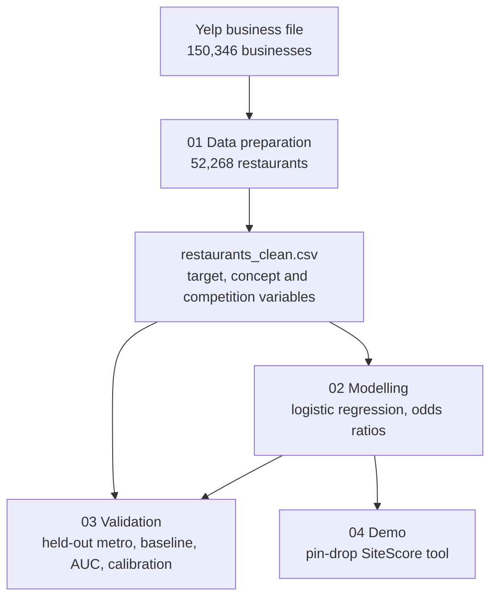

# SiteScore

**Can a restaurant founder see closure risk coming before signing a lease?**

SiteScore is a site-screening tool for restaurant founders, franchise teams, landlords and lenders. Drop a pin, choose a cuisine and price level, and get a closure-risk score with the factors behind it. It is built on an interpretable logistic regression trained on the [Yelp Open Dataset](https://business.yelp.com/data/resources/open-dataset/).

MGSC 661 Multivariate Statistics, McGill University (Fall 2026) · Hasan Malik, Pranjal Singh, Yangyang, Dario

---

## Key findings so far

From the data preparation step (52,268 restaurants across 11 metro areas, 33.1% closed at the Yelp snapshot). These are unadjusted comparisons; the model separates the effects.

| | Closed share |
|---|---|
| Chains (5+ locations) | 17.2% |
| Independents | 38.1% |
| Fewest restaurants within 500 m (bottom fifth) | 25.0% |
| Most restaurants within 500 m (top fifth) | 44.8% |

The density pattern holds when only open neighbours are counted (26.0% → 44.0%), so it is not an artifact of counting closed restaurants.

<p>
  
  
</p>

## Workflow



| Step | Notebook | Status | What it does |
|---|---|---|---|
| 01 | [`notebooks/01_data_prep.ipynb`](notebooks/01_data_prep.ipynb) | Done | Filters restaurants, builds the target, metro, price, cuisine, chain and competition variables, runs quality checks, saves charts |
| 02 | `notebooks/02_modelling.ipynb` | Done | Logistic regression built up in blocks; odds ratios, significance, diagnostics |
| 03 | `notebooks/03_validation.ipynb` | Planned | Held-out metro test vs. a naive baseline; AUC, calibration; robustness checks |
| 04 | `notebooks/04_demo` | Planned | Interactive demo |

## Data

The Yelp data is **not included** in this repository: Yelp licenses it for educational use and it should not be redistributed. See [`data/README.md`](data/README.md) for how to get it. Notebook 01 can download the one file it needs (the business file, about 120 MB) directly from Kaggle.

### Variables used in the main model

| Variable | Meaning |
|---|---|
| `closed` | Target: 1 = permanently closed at the Yelp snapshot (1 − `is_open`) |
| `price_tier` | Yelp price range 1–4, or "Missing" |
| `cuisine_group` | One of 14 cuisine groups |
| `is_chain` | Name appears at 5+ restaurants in the data |
| `log_n_rest_500m` | log(1 + other restaurants within 500 m) |
| `same_cuisine_share_500m` | Share of nearby restaurants with the same cuisine |
| `abs_price_gap`, `price_gap_missing` | Distance from the local average price, in either direction |
| `metro` | Metro area (11) |

The full data dictionary and every data decision are written to `notebooks/outputs/` when notebook 01 runs.

**Leakage rule:** no ratings, review counts, check-ins or neighbours' closure flags are used as inputs, because they are only known after opening or reflect the outcome itself.

## How to run

**Google Colab (easiest):** open a notebook from this repo in Colab (File → Open notebook → GitHub), then *Runtime → Run all*. Notebook 01 downloads the data from Kaggle; you need a free Kaggle account.

**Locally (VS Code or Jupyter):**

```bash
git clone <this repo's URL>
cd sitescore
pip install -r requirements.txt
```

Then open `notebooks/01_data_prep.ipynb`, set `DATA_SOURCE` in Step 0 (`"kaggle"`, `"drive"` or `"local"`), and run all cells. Outputs are written to `notebooks/outputs/`.

## Repository structure

```
sitescore/
├── README.md
├── requirements.txt
├── data/                  Yelp data goes here locally (not committed)
├── notebooks/
│   └── 01_data_prep.ipynb
├── reports/
│   └── figures/           Charts used in the deck and report
└── docs/
    ├── SiteScore_pitch_deck.pdf
    └── AI_USAGE_DISCLOSURE.md
```

## Limitations

- **Snapshot, not history.** Yelp shows each restaurant's status and surroundings at one point in time, so this is a closure-status model, not a forecast with a fixed horizon.
- **Unobserved factors.** Rent, owner experience and capital are not in the data, so results are associations, not causal effects.
- **Coverage.** The metros are mostly American; transfer to other cities (e.g. Montreal) is tested only indirectly, by holding out a metro.

## AI use

AI tools were used in this project. See [`docs/AI_USAGE_DISCLOSURE.md`](docs/AI_USAGE_DISCLOSURE.md).
